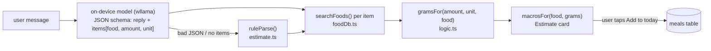

# Byte — the on-device AI food agent

Byte (the **Byte** tab, `app/src/pages/Chat.tsx`) is a chat where you say what you ate ("2 eggs and a bowl of rice", "صحن دولمة") and it proposes an entry for today's total. It is how **dynamic meals** (mom's cooking, one-offs) get logged; static meals stay one-tap templates (see [data-model.md](data-model.md)).

## The rule it follows

> The model only **reads** the message (which foods, how much, in which unit) and writes a short funny reply.
> **Every number** — grams and macros — is computed by deterministic code from the bundled USDA database ([food-database.md](food-database.md)).

The model is told never to write calorie numbers. If it does anyway, they're ignored: only its `items` list is used.

## Pipeline

| Step | File | What happens |
|---|---|---|
| 1. Ask | `ai/agent.ts` → `askByte()` | System prompt (personality + task) + few-shot examples + the last exchange + the message. Output is **constrained by a JSON schema** (`response_format: json_schema`, llama.cpp grammar), `temperature 0.4`, max 220 tokens. The answer is **streamed**: `completeJSON` passes each token to `partialReply()`, which pulls the `reply` string out of the half-written JSON (`reply` comes first in the schema), so Byte's bubble fills **word by word** with a blinking cursor and the mascot in *talking* mode. The estimate card appears once the full JSON (with `items`) has arrived. |
| 2. Fallback | `ai/estimate.ts` → `ruleParse()` | If the JSON can't be parsed, or has no items although the message looks like food (digits / "ate" / اكلت), a rule parser splits on `, + & and with و` and reads numbers, number words (a, two, half, نص…) and unit words (g, cup, bowl, صحن, ملعقة…). The card then shows a note asking to double-check. |
| 2b. Ground | `ai/estimate.ts` → `reconcile()` | Tiny models shuffle units ("3 *plate* egg") and copy their few-shot examples. So: model items that share **no word** with the user's message (after synonym/Arabic-prefix expansion) are dropped; amounts/units the rule parser read **explicitly** from the user's words override the model's (`mergeAmounts`); foods the rule parser found but the model missed are added. The model's job that survives: translating and normalising food names. |
| 3. Look up | `foodDb.ts` → `searchFoods()` | Best database match per item + up to 5 alternatives the user can switch to in the card. |
| 4. Grams | `logic.ts` → `gramsFor()` | g/ml as given → the food's own USDA portion (`1 large egg = 50 g`, `1 cup rice = 163 g`) → generic `UNIT_GRAMS` (bowl 300 g, plate 350 g…). The card says which: *as you said / USDA portion / typical portion*. See [logic.md](logic.md#ai-food-estimates). |
| 5. Macros | `foodDb.ts` → `macrosFor()` | per-100 g values × grams. |
| 6. Confirm | `Chat.tsx` | The estimate card lists items (editable grams, switchable database food), the total, a slot picker (default *Mom's meal 1*) and **Add to today** / **Skip**. |
| 7. Log | `Chat.tsx` → `db.meals.add` | Name = item names, macros = card total, `confidence` = `medium` if every item matched and none used a generic portion, else `low`; `note` = `Byte: 100 g Egg, whole, boiled…; …`. Items with no database match are left out of the total (and listed). |

## Personality

Byte is cheerful and cheeky, dramatic about food, loves puns, hypes eating enough for the bulk, replies in 1–2 short sentences, gives no medical advice. The model writes the reply; if it comes out flat (no `!`, `?` or emoji), `spice()` in `agent.ts` appends one of Byte's own quips (`QUIPS`). Canned lines (`ADDED`, `SKIPPED`, greeting) live in `Chat.tsx`.

## The mascot (`Mascot.tsx`)

A square (theme `--orange`) with square eyes, side nubs and little feet. Moods are drawn in the component, motion is CSS in `index.css` (`.mascot.*`):

| Mood | When | Animation |
|---|---|---|
| `sleeping` | no model downloaded | eyes closed, slow breathing, floating "z" |
| `idle` | ready | gentle bob, blinks every ~4 s |
| `thinking` | model loading / generating | eyes dart left-right in steps, three dots pulse |
| `talking` | 1.6 s after a reply | mouth flaps (stepped), quick bob |
| `happy` | 2.2 s after "Add to today" | `^ ^` eyes, wide mouth, three hops |
| `sad` | engine error | lowered eyes, droop |

`prefers-reduced-motion` stops all of it. A small idle Byte is the avatar on its chat bubbles; the AI brain card in Settings shows it sleeping/happy.

## Runtime (`ai/engine.ts`)

- **wllama 3** (`@wllama/wllama`) = llama.cpp compiled to WebAssembly, runs in a Web Worker; uses **WebGPU** when the WebView has it, otherwise CPU. The ~8.7 MB `wllama.wasm` is bundled (precached); the JS is lazy-loaded the first time the AI is used.
- **Multi-threading** needs cross-origin isolation: the dev/preview servers (`vite.config.ts`) and the Android app (`MainActivity.java`, custom `BridgeWebViewClient`) send `Cross-Origin-Opener-Policy: same-origin` + `Cross-Origin-Embedder-Policy: require-corp`. Without it wllama falls back to one thread (slower, still works).
- **Use the GPU** (Settings → AI brain, pref `aiGpu`, default on): off loads with `n_gpu_layers: 0` (CPU only) — for phones whose WebGPU path is slow or broken. Changing it unloads the model; the next message reloads it.
- `n_ctx 2048`, `n_batch 512`. The model is loaded into memory on first use (opening the Byte tab warms it up) and kept until the app closes or another model is chosen.
- A small store (`useEngine()`) exposes `idle / downloading / loading / ready / thinking / error` to the UI.

## Getting a model (Settings → AI brain)

The APK ships **without** a model. The user downloads one in-app, once:

- **Suggested models** (`ai/models.ts` → `CATALOG`), smallest first: Gemma 3 270M (292 MB), SmolLM2 360M (386 MB), Qwen3 0.6B (397 MB, thinking turned off via `chat_template_kwargs`), **Qwen2.5 0.5B Instruct Q4_K_M (491 MB, recommended)**, Qwen2.5 1.5B (1.1 GB, 6 GB+ RAM phones). All GGUF from Hugging Face, free licences.
- **Find compatible free models online** (`findCompatibleModels()`): searches the Hugging Face API for small instruct GGUF repos with a free licence (Apache-2.0, MIT, Gemma, Llama 3.x), picks one Q4_K_M/Q4_0/Q8_0 file per repo (≤ 2 GB, no split files), checks live sizes, and rates each against the phone: `navigator.deviceMemory` → budget (8 GB → 1.3 GB, 6 → 1 GB, 4 → 700 MB, less → 450 MB; unknown → 700 MB) → *fits / tight / too big*.
- **Download** shows progress and can be cancelled; it calls `navigator.storage.persist()` and stores the file in the browser's private storage (OPFS via wllama's `ModelManager`). When done, the model becomes the one in use (`prefs.aiModel`).
- The download runs in the engine module, not the Settings page, so it **keeps going when you switch tabs** (but not if the app is closed or the phone kills it in the background). While it runs, the download owns the engine state: the **Byte** tab shows its progress, `ensureLoaded()` won't load a model next to it (RAM), and only an already-loaded model can answer.
- Downloaded models are listed with **Use** / **Delete**.

Network use: this card (search + download) is the **only** place the app goes online, and only when the user taps a button. Everything else — the database, the model once downloaded, the chat — is offline.

## Chat storage

Messages (incl. estimate cards and their added/skipped state) are kept in `localStorage` key `mt-chat`, last 60, per device, **not** in backups. "Clear chat" empties it. Logged meals themselves are normal `meals` rows (in backups).

## Limits worth knowing

- Small models misread mixed or vague meals. The card is the safety net: switch the database food, fix grams, or Skip.
- Iraqi dishes not in USDA are mapped through `SYNONYMS` (e.g. dolma → stuffed grape leaves, kubba → meatballs); some are approximations, hence `confidence` ≤ medium.
- Streaming starts only after the model has read the prompt (≈450 tokens): on the dev PC's CPU the first word came after ≈29 s, then words flow at a few per second. The typing dots cover the wait.
- Speed: measured in headless Chromium on the dev PC with Qwen2.5 0.5B Q4_K_M: model load ≈5 s, an answer ≈33–43 s on CPU (prompt ≈450 tokens + up to 220 output). Phones will be similar or slower; smaller models are faster but sloppier.

## Verified end-to-end (dev, headless Chromium)

Downloaded Qwen2.5 0.5B through Settings (491 MB, `crossOriginIsolated` true), then: “I ate 3 eggs, a plate of rice and a glass of milk” → 3 × egg 150 g (USDA portion) + rice 350 g + whole milk 250 g = 820 kcal, *Add to today* logged it; “اكلت صحن دولمة وخبز” → grape leaves stuffed with rice 350 g + pita (one piece) after grounding removed a copied example item.
