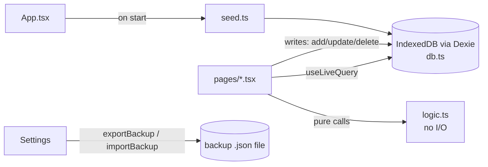

# Architecture

## Stack

| Layer | Choice | Why |
|---|---|---|
| UI | React 19 + TypeScript, Vite 8 | Fast to build with an AI assistant; runs in any phone browser |
| Storage | IndexedDB via **Dexie 4** + `dexie-react-hooks` (`useLiveQuery`) | Local, offline, reactive; no server |
| Offline / install | **vite-plugin-pwa** (Workbox `generateSW`, `autoUpdate`) | Installable PWA; precaches JS/CSS/HTML/SVG/fonts |
| Fonts | `@fontsource-variable/readex-pro` | Bundled — no network at runtime; one readable font that also covers Arabic |
| Sound | WebAudio API (`src/sound.ts`) | 8-bit effects synthesized at runtime — no audio files to bundle |
| Food icons | `@iconify-json/fluent-emoji-flat`, `emojilib`, `unicode-emoji-json` (**dev** deps) | Build-time source for the generated SVG food icons; nothing fetched at runtime |
| Food database | USDA FoodData Central (SR Legacy + FNDDS), built by `scripts/food-db.mjs` | Shipped as `public/foods.json`; see [food-database.md](food-database.md) |
| On-device AI | `@wllama/wllama` (llama.cpp → WASM, WebGPU/CPU) | Byte; the model is downloaded in-app, not bundled — see [ai.md](ai.md) |
| Lint | oxlint | Ships with the Vite template |
| Android APK | **Capacitor 8** (`app/android/`, appId `com.mtmad.mtmacro`) | Wraps the built `dist/` in a WebView; same code, installable APK |

**Why a PWA and not native/Flutter:** the dev machine has Node but no Flutter or Android SDK. The PWA is now also wrapped with **Capacitor** into a test APK (see [development.md](development.md#android-apk)); later it can add local notifications (reminders) and native SQLite / on-device model plugins.

## Folder layout

```
mt-macro/
├── AGENTS.md               # project guide + docs index (start here)
├── blueprint.md             # product brief / research questions
├── docs/                    # all project documentation (this folder)
└── app/                     # the PWA
    ├── index.html
    ├── vite.config.ts       # React + PWA manifest + Workbox precache patterns
    ├── capacitor.config.ts  # Capacitor app id/name, webDir = dist, SystemBars hidden (fullscreen)
    ├── android/             # generated Capacitor Android project (Gradle)
    ├── public/              # logo + app icons, foods.json (food DB), food/*.svg (food icons)
    ├── scripts/screenshot.mjs  # headless phone screenshots for visual checks
    ├── scripts/food-icons.mjs  # emoji DB → public/food/*.svg + word map (src/food-icons.json)
    ├── scripts/food-db.mjs  # USDA CSVs → public/foods.json (cache in .cache/usda/, git-ignored)
    ├── scripts/logo.mjs     # regenerates the pixel-art logo + icons in public/ and Android launcher icons/splash
    └── src/
        ├── main.tsx         # entry: fonts + CSS + <App/>
        ├── App.tsx          # seeds DB, splash, delegated button sounds, bottom tab bar, page switch
        ├── Splash.tsx       # intro: logo screen → 4 falling columns
        ├── sound.ts         # 8-bit WebAudio sound effects (+ tap vibration)
        ├── prefs.ts         # device prefs in localStorage: theme, accent, transition, splash, sound, volume, vibrate
        ├── foodIcons.ts     # meal name → food icon
        ├── food-icons.json  # generated: icon slugs + search words
        ├── foodDb.ts        # food database: load, search, portions, macros
        ├── palettes.ts      # colour palette families + token derivation
        ├── Mascot.tsx       # Byte, the square AI mascot
        ├── ai/              # engine.ts (wllama runtime), models.ts (catalogue + HF lookup), agent.ts (prompt), estimate.ts (DB maths)
        ├── db.ts            # Dexie schema, types, targets, recipe versioning, backup
        ├── seed.ts          # default recipes (+ duplicate cleanup)
        ├── logic.ts         # pure rules: dates, sums, weight trend, sleep stats, recovery text
        ├── ui.tsx           # Card, Bar, Stat, NumField, Plate, FoodIcon
        ├── art.tsx          # header SVG illustrations + tab icons
        ├── index.css        # design tokens + all styles
        └── pages/           # Today (Food), Chat (Byte), Calendar (Days), Weight, Sleep, Recipes (Meals), Settings
```

## Data flow



- Pages read with `useLiveQuery`, so any write anywhere re-renders the affected screens automatically.
- `logic.ts` is pure (no DB, no React) so it can be unit-tested and reused by a future coach agent.
- Navigation is a simple `useState` tab switch in `App.tsx` (no router); `<main key={tab}>` remounts per tab for the page transition.
- UI prefs (theme, accent, sound…) live in `localStorage` via `prefs.ts`, separate from the Dexie data.

## Offline / PWA

- `vite.config.ts` → `workbox.globPatterns: ['**/*.{js,css,html,svg,png,woff2,json,wasm}']`, `maximumFileSizeToCacheInBytes` 12 MB (the AI runtime wasm is ~8.7 MB). **If you add a new asset type (png, webp, json…), add its extension here** or it won't work offline.
- Data never leaves the device; each browser/device has its own separate database.
- In the APK the app is served from the WebView's local `https://localhost` origin, so its IndexedDB is **separate** from the browser PWA's — move data with Export/Import JSON.

## Android fullscreen

The APK runs **immersive fullscreen** — no status bar, no navigation bar, no grey strips:

- `MainActivity.java` draws edge-to-edge (`setDecorFitsSystemWindows(false)`), lets content go under the camera cutout (`LAYOUT_IN_DISPLAY_CUTOUT_MODE_ALWAYS`/`SHORT_EDGES`), hides `systemBars()` with `BEHAVIOR_SHOW_TRANSIENT_BARS_BY_SWIPE` and re-hides them whenever the window regains focus (after dialogs, keyboard, app switch). Swipe from an edge to peek at the bars.
- `capacitor.config.ts` → `plugins.SystemBars: { hidden: true, insetsHandling: 'css', initialViewportFitValueHint: 'cover' }`; `index.html` has `viewport-fit=cover`. Capacitor injects `--safe-area-inset-*` CSS vars; `index.css` combines them with `env(safe-area-inset-*)` into `--safe-top` / `--safe-bottom`, used by `main` padding and the tab bar so nothing sits under the cutout.
- `styles.xml`: window background, Android 12+ system splash background and pre-12 `splash.png` all use the splash colour `#10201E` (`values/colors.xml`), so the hand-off to the web splash is seamless. Status/nav bar colours are transparent.
- The PWA manifest uses `display: 'fullscreen'` for the same effect when installed from the browser.

## Network use

The app is offline. **One exception, always user-initiated:** Settings → AI brain → *Find compatible free models* (Hugging Face API) and *Download* (the model file from Hugging Face). Nothing else calls the network at runtime; the food database, icons, fonts and AI runtime are bundled.

## Cross-origin isolation

For multi-threaded WebAssembly (faster AI) the app is served with `Cross-Origin-Opener-Policy: same-origin` and `Cross-Origin-Embedder-Policy: require-corp`: Vite dev/preview via `server.headers`/`preview.headers`, Android via a `BridgeWebViewClient` subclass in `MainActivity.java` that adds the headers to every local response. Hugging Face downloads are CORS requests, which COEP allows. Any future cross-origin ``/`<script>` would need CORS/CORP headers.
